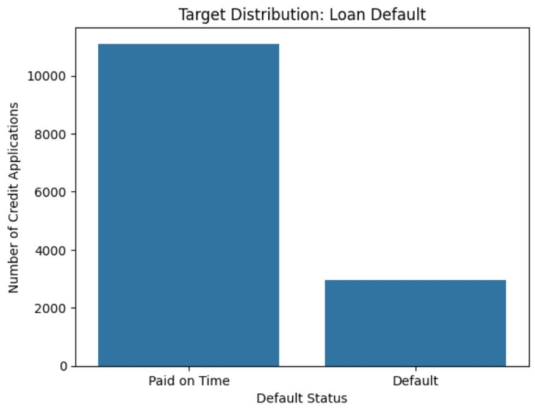
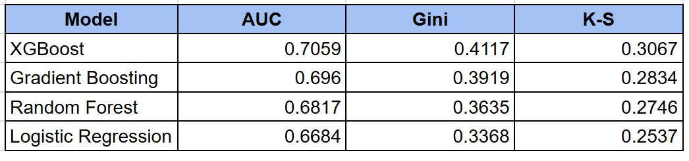
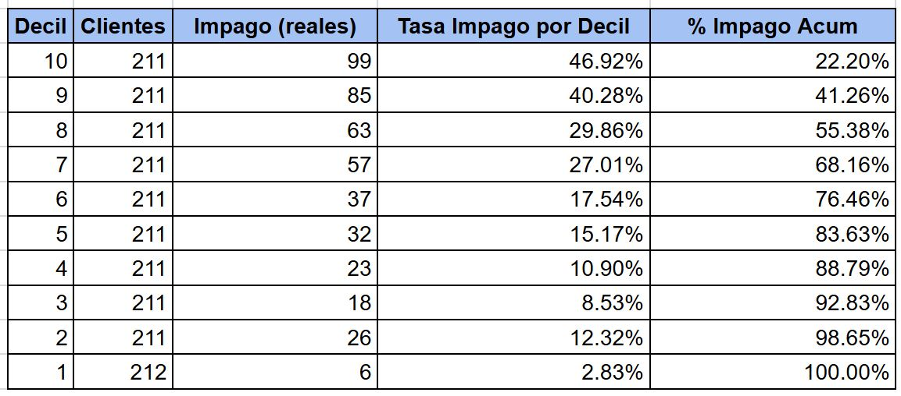

# Predicción de riesgo de impago crediticio con Machine Learning

Proyecto de clasificación de riesgo de impago crediticio que compara cuatro modelos de clasificación. Incluye análisis exploratorio de datos (*EDA*), pre-procesamiento para evitar fuga de información (*data leakage*), manejo de clases desequilibradas, optimización de los modelos (*Grid Search*) y evaluación de rendimiento a través de métricas cómo ROC-AUC, Gini y K-S. El modelo final, un XGBoost, sirve de apoyo a una estrategia de concesión de crédito fundamentada en deciles de riesgo.

## Objetivo del proyecto

El objetivo principal del proyecto es transformar los resultados de un modelo predictivo de riesgo crediticio en una propuesta de valor a negocio, mediante segmentación de clientes de acuerdo a su probabilidad estimada de impago.

Como objetivo secundario se construyen 4 modelos de clasificación de Aprendizaje Supervisado (ML) y se comparan utilizando métricas adecuadas para evaluar su capacidad de discriminación en un problema con clases desbalanceadas.

## Datos empleados

Se usa una base de datos, de 14,067 solicitudes de crédito, con variables cualitativas y cuantitativas relacionadas con distintos aspectos de perfil y comportamiento crediticio del cliente. Las variables pueden agruparse conceptualmente en las siguientes categorías:

- Score de riesgo
- Capacidad de pago
- Alerta de riesgo
- Endeudamiento
- Historial crediticio
- Comportamiento pago
- Exposición sector
- Perfil financiero
- Perfil demográfico

La variable objetivo *"ind_malo"* identifica si el cliente presentó impago (*Default*) o pago en tiempo (*Paid on Time*). La distribución presenta un desbalance aproximado de 21% de casos de impago y 79% de pagos en tiempo, característica que se considera durante el entrenamiento y evaluación de los modelos.

## Metodología

Para poder llevar a cabo el entrenamiento de los 4 modelos se siguieron los pasos mostrados a continuación.

- EDA: Exploración inicial de los datos para conocer su estructura, cardinalidad de variables categóricas, distribución y rangos de variables numéricas, valores faltantes y comportamiento de la variable objetivo.
  
- Manejo de desbalance de clases: La variable objetivo presenta 11,097 casos de Paid on Time y 2,970 casos de Default. Para compensar este desbalance se utilizaron mecanismos de ponderación de clases durante el entrenamiento, como `class_weight = "balanced"` y `scale_pos_weight`.
  

 
  
- División de datos: Entrenamiento `70%` / Validation `15%` / Prueba `15%` preservando la distribución original de la variable objetivo mediante estratificación.
  
- Imputación de valores: Los valores faltantes fueron sustituidos utilizando la mediana calculada únicamente sobre el conjunto de entrenamiento, reduciendo el efecto de valores extremos y evitando data leakage.
  
- Escalado de variables numéricas: Las variables numéricas no normalizadas fueron transformadas utilizando parámetros aprendidos exclusivamente del conjunto de entrenamiento.
  
- One-Hot Encoding de variables categóricas: Las variables categóricas nominales fueron transformadas mediante codificación One-Hot, ajustando el encoder únicamente con los datos de entrenamiento.

## Modelos

Se entrenaron y compararon cuatro modelos (`Logistic Regression`, `XGBoost`, `Random Forest Classifier` y `Gradient Boosting`) de clasificación supervisada para identificar el enfoque con mejor capacidad de discriminación de riesgo.

Se empleo *Fine-tuning* con `Grid Search` para optimizar los hiperparámetros de los cuatro modelos, utilizando ROC-AUC como métrica de selección.

Los modelos fueron evaluados mediante `ROC-AUC`, `Coeficiente de Gini` y `K-S (*Kolmogorov-Smirnov*)`, métricas adecuadas para medir la capacidad de ranking y separación entre clientes con pago en tiempo y con impago.

### Rendimiento de los modelos

Después del proceso de optimización mediante Grid Search, los cuatro modelos fueron evaluados sobre el conjunto de validación. `XGBoost` tuvo el mejor desempeño general, con un ROC-AUC de 0.7059, un Gini de 0.4117 y un K-S de 0.3067, seguido muy de cerca por `Gradient Boosting`.

 

## Estrategia de negocio: Propuesta

A partir de las probabilidades de impago generadas por el modelo final `XGBoost`, los clientes fueron agrupados en deciles de riesgo, donde el `decil 1` representa el menor riesgo estimado y el `decil 10` el mayor.

Con base en esta segmentación se propusieron tres grupos para apoyar la estrategia de originación de crédito:

- Riesgo bajo — `Deciles 1 a 4`: Clientes con menores probabilidades observadas de impago, candidatos a seguir un proceso estándar de aprobación crédito.

- Riesgo medio — `Deciles 5 a 7`: Clientes que podrían requerir validaciones adicionales, límites de crédito más conservadores o condiciones más estrictas para otorgar el crédito.

- Riesgo alto — `Deciles 8 a 10`: Segmento sujeto a criterios de aprobación más estricto o posible rechazo según el perfil de riesgo de la institución.

 

Los `deciles 8 a 10` representan aproximadamente el 30% de los clientes, pero concentran el 55.38% de los impagos observados, mostrando cómo los resultados del modelo pueden ayudar a identificar y priorizar los segmentos con mayor riesgo crediticio y tomar deciciones de negocio basadas en datos.

## Tecnología

Se emplearon las siguientes librerías de Python:

- Pandas
- NumPy
- Matplotlib
- Seaborn
- Scikit-learn
- XGBoost

## Estructura del repositorio
- data/
- notebook/
- README.md
- ESP_README.md
- presentation_pdf/
